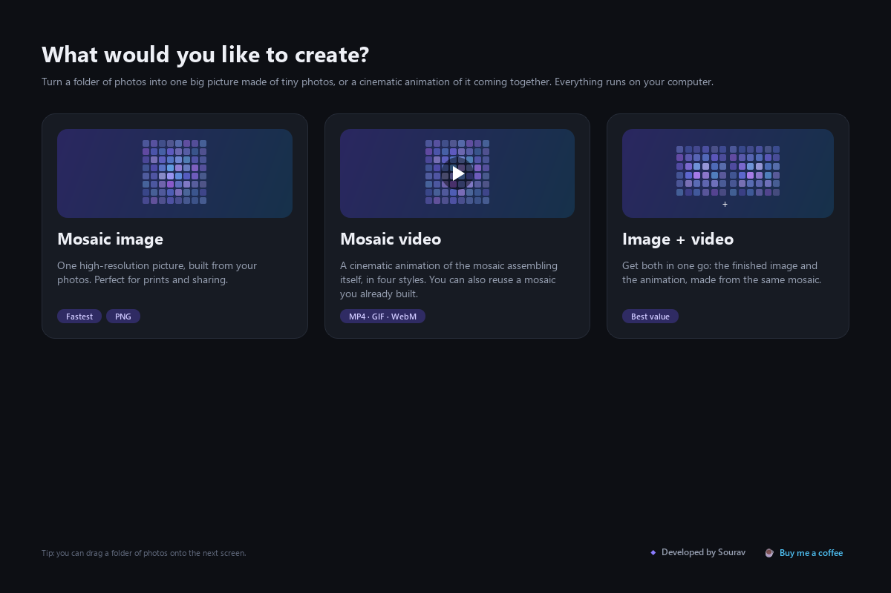
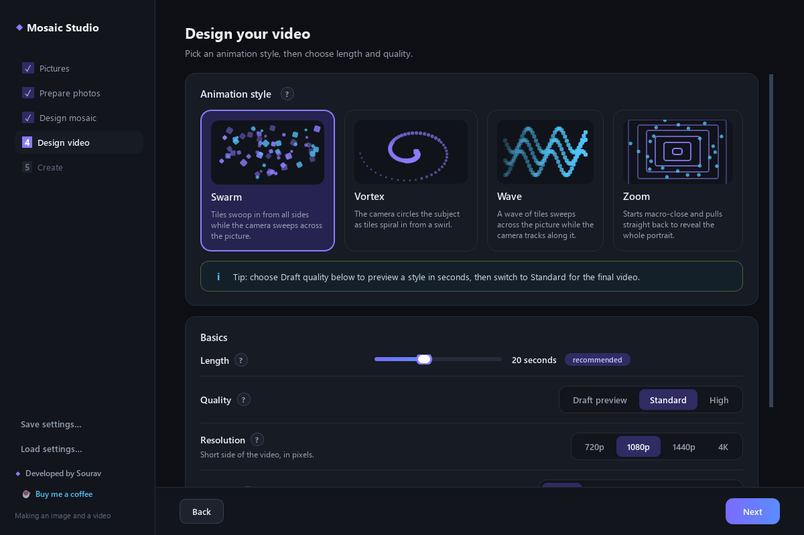

# Mosaic Studio

Turn a folder of photos into **one big picture made of tiny photos**, or into a **cinematic animation** of that
mosaic assembling itself. Everything runs offline on your own Windows PC, with a clean guided app (or a command line
if you prefer).

<p align="center">
  
</p>

## Download (Windows)

1. Get **MosaicStudio-vX.Y.Z-windows.zip** from the [latest release](https://github.com/mahatosourav00/mosaic-video/releases/latest) and unzip it anywhere (keep the folder together).
2. Double-click **MosaicStudio.exe**.

Nothing else needs to be installed: Python, Qt, OpenCV and FFmpeg are inside.

> Windows may say **"Windows protected your PC"** because the app is not code-signed yet. Click **More info**, then **Run anyway**.

Requirements: Windows 10 / 11 (64-bit). Videos are rendered with OpenGL, so you need a graphics driver that supports
OpenGL 3.3 (an integrated GPU is fine).

## What you can make

| Goal | You get |
|---|---|
| **Mosaic image** | One high-resolution picture built from your photos: PNG, JPEG, WebP or TIFF, for screens or for print. |
| **Mosaic video** | An animation of the mosaic assembling itself, in four styles, as MP4 (H.264 / H.265), WebM or GIF, 720p to 4K. A mosaic you built earlier can be reused to try new styles in seconds. |
| **Both** | The finished image and the animation, from the same mosaic. |

## The app

A short guided flow with a progress rail: **Pictures → Prepare photos → Design mosaic → Design video → Create**.
Steps that do not apply to your goal are left out.

<p align="center">
  
  
</p>

- **Made for beginners:** a **?** next to every option explains it in plain language and says what is recommended.
  Presets (Quick draft, Balanced, Best quality) and live advice, such as how often each photo will repeat.
- **Skip what you do not need:** every photo-preparation step has its own switch, plus a master "Skip all preparation".
  **Preview what will change** shows which photos would be kept, trimmed, left out or treated as duplicates.
- **Preview before you build:** a fast draft that has exactly the arrangement of the final mosaic.
- **Your photos, your way:** several photo folders, folders to leave out, a sub-folder switch, black and white, gap colour.
- **Print-ready:** choose a physical size (inches or cm) and 150 / 300 / 600 DPI; the DPI is saved inside the file.
- **Settings files:** save your settings and load them again later (your folders are never stored in them).
- **Stays responsive:** the work runs in a separate process, so the window never freezes and **Cancel** really cancels.

<p align="center">
  
</p>

### Animation styles

Each style has its own camera, so you can tell them apart at a glance.

| Style | Camera and motion |
|---|---|
| **Swarm** | Tiles swoop in from all sides while the camera orbits and sweeps across the picture; big "showcase" photos fly past. |
| **Vortex** | The camera circles the subject as the tiles spiral in from a swirl. |
| **Wave** | A level sideways tracking shot follows a wave of tiles sweeping across the picture. |
| **Zoom** | Starts macro-close and pulls straight back along the lens axis to reveal the whole portrait. |

Vortex, Wave and Zoom open with tiles already in flight and keep the showcase photos away from the face; Swarm is
the original style. Every style ends on a calm, straight full frame with a soft glow, drifting dust and a light sweep.

### Photo preparation

EXIF rotation, border and frame trimming, blur / size filtering, near-duplicate removal, face- and detail-aware square
cropping, and an on-disk cache so later runs are fast. An experimental "fix sideways photos" option is available (off by
default).

## Command line

The same engine can be used without the app (from a source checkout, see below).

```bash
# 1. Build the mosaic (writes mosaic.png, scene.json and a cache into --out)
python -m mosaicvid build --tiles "path\to\photos" --main "path\to\main.jpg" --out output\run1 ^
  --num-tiles 3000 --cell-px 128 --max-uses 12 --min-distance 6 --subtiles --subtile-percent 25 ^
  --tint 0.7 --blend 0.15 --subject-weight 0.7 --aspect 9:16

# 2. Render a video from it (--preview = fast low-res draft)
python -m mosaicvid video --scene output\run1\scene.json --style vortex [--preview --duration 20 --res 1080 --format mp4]

# Check what photo preparation would do, without building anything (contact sheets + report.csv)
python -m mosaicvid inspect --tiles "path\to\photos" --out output\run1

# Run a job file (this is what the app uses; progress is printed as one JSON event per line)
python -m mosaicvid run --job job.json
```

`python -m mosaicvid <command> --help` lists every option. A job file is plain JSON (`mode`: `image`, `video`, `both` or
`inspect`, plus paths and a `settings` object); see the top of [`mosaicvid/runner.py`](mosaicvid/runner.py).

## Run from source

```bash
python -m venv .venv
.venv\Scripts\python.exe -m pip install -r requirements.txt
.venv\Scripts\python.exe -m mosaicvid.gui          # open the app
.venv\Scripts\python.exe -m pytest -q              # run the tests (18)
```

Python 3.12 on Windows is what it is tested with. FFmpeg comes from the `imageio-ffmpeg` package.

## Build the .exe yourself

```bash
.venv\Scripts\python.exe -m pip install pyinstaller
.venv\Scripts\python.exe packaging\build_exe.py
```

This produces `dist\MosaicStudio\MosaicStudio.exe` (a self-contained folder; zip it to share).

## Project layout

| Path | Role |
|---|---|
| `mosaicvid/preprocess.py` | photo ingestion and cleanup, cache |
| `mosaicvid/subject.py` | subject (face / saliency) map |
| `mosaicvid/solver.py` | grid, matching, assignment, still render, scene files |
| `mosaicvid/animation.py` | per-tile flights, cameras and the four animation styles |
| `mosaicvid/render_gl.py` | headless OpenGL renderer and FFmpeg export |
| `mosaicvid/settings.py` | every user option in one serialisable object |
| `mosaicvid/runner.py` | one job entry point (image / video / both / inspect) with JSON progress events |
| `mosaicvid/report.py` | contact sheets and CSV report of what preparation did |
| `mosaicvid/cli.py` | `build`, `inspect`, `video` and `run` commands |
| `mosaicvid/app.py` | entry point for the window and the packaged exe |
| `mosaicvid/gui/` | the PySide6 app: pages, widgets, theme, help text |
| `packaging/` | icon generator and the PyInstaller build script |
| `tests/` | automated tests |

Generated media (videos, stills, caches) and build output stay out of git on purpose; see `.gitignore`.

## Roadmap

- Mixed tile shapes, irregular mosaic shapes from a mask, and using frames from your own videos as tiles
- Reliable automatic rotation of sideways photos (needs an orientation model)
- Music and title overlays for videos
- In-app video playback, a Windows installer and code signing
- Scale tests (thousands of photos) and renderer tests

## Credits and support

Developed by **Sourav**. If this helped you make something you love, you can support its development with the
**Buy me a coffee** button inside the app (it shows a UPI QR code).

## License

No license has been chosen yet, so by default all rights are reserved. Open an issue if you would like to use the code.
